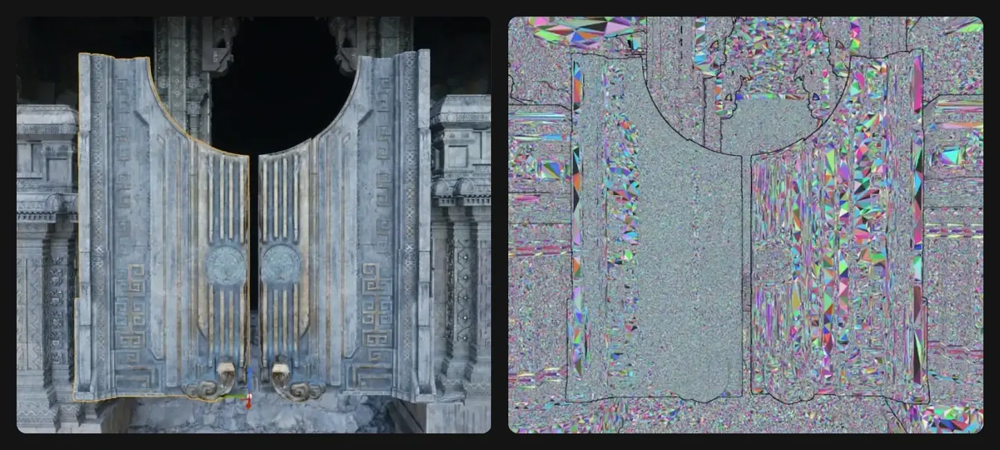

::: step Nanite — наш базовый рендер-путь для всей статичной геометрии {#base-path}
Не-Nanite ассеты возможны, но это исключение.
:::

::: step Полигонаж всё ещё имеет значение {#polycount}
Да, сегодня мы можем позволить себе в разы больше полигонов, но тяжёлые high-poly меши занимают больше места на диске и создают большую нагрузку на стриминг геометрии.
:::

## Что идёт в Nanite {#verdicts}

::: yes Статик-меши {#static-mesh}
Пропсы, архитектура, скалы, сканы.
:::

::: yes Модульные стены и панели {#modular}
В том числе через PCG и ISM/HISM.
:::

::: yes Spline-меши {#spline-mesh}
Дороги, трубы, провода.
:::

::: yes Ландшафт и растительность {#terrain}
**Mesh Terrain** и **Nanite Foliage**.
:::

::: yes Geometry Collections {#geometry-collections}
Разрушаемость.
:::

::: yes Debris {#debris}
Вокселями.
:::

::: yes Мелкие пропсы {#small-props}
100–300 треугольников: гайки, гильзы. Выигрыша нет, но и вреда нет — включаем ради единого пути.
:::

::: maybe Скелетные меши {#skeletal-mesh}
Персонажи, техника со скелетной анимацией. Поддерживается с UE 5.5, но это отдельный пайплайн.

Скорее всего для персонажей не будем использовать, а вот для больших големов (если такие будут) рассмотрим отдельно.
:::

::: no Прозрачное {#translucent}
Стекло, вода, дым, decals-меши, любой Translucent, Masked.

> [!TIP] Замена стеклу
> У нас есть фейковое стекло — `MM_GlassFake`, оно не имеет прозрачности.
:::

::: no Morph targets {#morph-targets}
И блендшейпы: не поддерживаются.
:::

::: no Forward Rendering, VR, MSAA {#forward}
Всё, что рендерится этими путями.
:::

## Нормали {#normals}

::: third Плотный меш без сглаживания {#faceted-normals} | Запрет
Нельзя импортировать плотный меш с фасетными (несглаженными) нормалями. Каждый hard edge = разрыв вершин.
:::

::: third Вершин меньше, чем треугольников {#vertex-ratio} | Правило
2:1 — уже проблема, 3:1 — меш полностью фасетный: медленный путь рендера и вес в разы больше.
:::

::: third Auto Smooth by angle {#auto-smooth} | Проверка
С низким порогом превращает плотный меш в фасеты.
:::

::: half Где hard edges допустимы {#smoothing-groups} | Правило
Sharp edges и Auto Smooth — осознанно, только на hard-surface. Органика, сканы, скульпты — всё Smooth.

- Средние пропсы и крупные ассеты — фаски вместо жёстких углов.
- Мелкие ассеты и детали — split normals.
:::

::: half Почему hard edges дорогие {#split-normals} | Внимание
Unreal хранит split normals как разрыв вершин: на hard edge одна вершина становится несколькими. Вершин в Unreal больше, чем в DCC, и Nanite хуже упрощает такой меш.
:::

::: card Пример {#example}

Слева нормали не сглажены, справа сглажены. По итогу Nanite не может упростить геометрию слева, так как воспринимает каждый треугольник как подмеш.
:::

## Топология и UV {#topology}

::: third Замкнутая геометрия {#manifold} | Совет
Дыр, внутренних граней и non-manifold рёбер — минимум. Но не критично.
:::

::: third Длинные треугольники {#long-triangles} | Запрет
Избегать: Nanite разобьёт их сам, но в этих местах возможны проблемы.
:::

::: third Тонкие детали {#thin-details} | Проверка
Провода, прутья, сетки деформируются при упрощении. Смотреть на дистанции.
:::

::: third Лупы на больших поверхностях {#culling-loops} | Правило
Дорезать: локальные участки Nanite лучше отсекает и упрощает.
:::

::: third Крупные UV-острова {#uv-islands} | Правило
UV-острова крупнее, швов меньше. Каждый шов = дублирование вершин. Но не ценой растяжений развёртки и потери тексельной плотности.
:::

::: third Lightmap UV {#no-lightmap-uv} | Запрет
Снять **Generate Lightmap UVs** при импорте: Lightmass не используем, лишний канал — данные и время билда.
:::

## Китбаш {#kitbash}

::: third Китбаш разрешён {#kitbash-allowed} | Правило
Глубоко утопленная геометрия отсекается почти бесплатно.
:::

::: third Но не вплотную {#overlap} | Запрет
Панель в 1–5 см над стеной, накладка «в ноль»: издалека зазор меньше пикселя, и Nanite рисует оба слоя — overdraw.
:::

::: third Правило зазора {#gap-rule} | Правило
Либо утопить глубоко (больше 10–20 см внутрь), либо интегрировать в один меш. В первую очередь — для крупных накладок, которые видны издалека.
:::

## Материалы {#materials}

::: third Opaque и Masked {#opaque-masked} | Правило
Других Blend Mode нет. Masked — в очень редких случаях.
:::

::: third Translucent, Additive, Modulate {#translucent-materials} | Запрет
Заменятся на дефолтный материал с warning в логе. Стекло, вода, дымка — отдельный не-Nanite меш.
:::

::: third Меш-декали {#mesh-decals} | Запрет
Не используем: они почти всегда Translucent.
:::

::: third Virtual Texture {#virtual-texture} | Совет
Для текстур от 2K по одной из сторон.
:::

::: third Vertex Interpolator и Custom UV {#vertex-interpolator} | Внимание
Работают, но считаются 3 раза на пиксель.
:::

::: third WPO {#no-wpo} | Запрет
World Position Offset на Nanite-мешах не используем.
:::

## Данные меша {#mesh-data}

::: third Vertex Color {#vertex-color} | Внимание
Поддерживается, как и несколько UV. Но VC плывут при перестройке кластеров, а лишние UV — память на больших мешах.
:::

::: third VC общий для инстансов {#vertex-color-instances} | Правило
Красить отдельный экземпляр через Vertex Paint нельзя. Вариации — Mesh Texture Paint, PerInstanceCustomData или материал.
:::

::: third Тангенты {#tangents} | Внимание
Не хранятся, выводятся в пиксельном шейдере. На UV-швах с жёсткими нормалями возможны артефакты. Хранение можно включить, но ассет станет тяжелее на порядок.
:::

::: card Position Precision {#position-precision} | Правило
**Auto**. Менять, только если скажет техартист: на огромных мешах и микродеталях геометрия может «дрожать».
:::

## Displacement {#displacement}

::: card Static Displacement вместо POM {#static-displacement} | Основной способ
POM не используем. Сколы и повреждения на бетоне, кирпиче, панелях делаем реальной геометрией или Static Displacement. Смещение запекается при билде Nanite, на выходе обычный плотный Nanite-меш, на рантайме ничего не стоит.

**Static Mesh Editor → Nanite Settings:** Displacement UV Channel → Displacement Maps (элемент = слот материала, пустой = слот без смещения) → Magnitude, Center → Trim Relative Error → Apply.
:::

::: third Trim Relative Error = 0 {#trim-zero} | Запрет
При `0` карты молча игнорируются, displacement не запекается. Trim одновременно включает displacement и задаёт плотность тесселяции.
:::

::: third Trim зависит от размера меша {#trim-size} | Заметка
Допуск считается от площади меша, поэтому одно число на всё не работает. При `0.04`: панель 1×1 м ≈ 0.6 мм, стена 4×3 м ≈ 2 мм, фасад 20×10 м ≈ 8 мм. Целимся в 1–2 мм: модули до ~4 м — `0.04`, крупные — `0.02`, мелкие — `0.1`. Плотность сверять в Output Log: `Adaptive tessellate … tris`.
:::

::: third Trim упрощает весь меш {#trim-simplifies} | Заметка
Trim не только задаёт плотность рельефа, но и обрезает всю детализацию меша мельче допуска, во всех слотах, даже без displacement. Фаски, пазы и швы мельче допуска сгладятся. Если в меше есть очень мелкая важная деталь, подбирай Trim по ней или выноси рельеф в отдельный меш.
:::

::: third Magnitude и Center {#magnitude-center} | Заметка
Смещение = (height − Center) × Magnitude, в см, вдоль нормали вершины. Magnitude — реальная глубина рельефа. Center по умолчанию `0`, то есть всё выдавливается наружу. Для сколов и вмятин (белое = поверхность) нужен `1`, для карты со средним серым — `0.5`.
:::

::: third Height map {#height-map} | Заметка
Важна битность исходника: 16-битный PNG или EXR. 8 бит дают ступени на пологих сколах. Настройка сжатия текстуры не влияет: билд читает исходник. Отдельная grayscale-текстура. Если всё же RGBA8, берётся канал R.
:::

::: third Normal map {#displacement-normal} | Заметка
Нужен: displacement не пересчитывает нормали, новые вершины получают интерполированную исходную. Без normal map рельеф читается только силуэтом и тенями.
:::

::: third Рельеф на жёстких рёбрах и UV-швах {#displacement-seams} | Запрет
Щелей не будет, смещения совпадающих вершин усредняются. Но на жёстком ребре угол уезжает по средней нормали, а на шве получается среднее двух выборок. Рельеф держать вне углов и швов.
:::

::: third Цена {#displacement-cost} | Заметка
Каждый вариант повреждений — отдельный плотный ассет: диск и время билда. Через Material Instance разнообразие не сделать, нужны варианты меша.
:::

### Runtime-тесселяция (материал) {#runtime-tessellation}

::: half Magnitude без запаса {#magnitude} | Запрет
Не ставить `100`, чтобы потом скейлить в шейдере: **Displacement Scaling → Magnitude** в материале расширяет баунды примитива и инстансов. Большие значения ломают куллинг, особенно в тенях. Ставить реальную максимальную глубину.
:::

::: half Height map для материала {#material-height-map} | Заметка
BC4 (**Texture Compression: Alpha**) или без сжатия. Не паковать в канал с нормалью.
:::

## Коллизия {#collision}

::: card Без Complex Collision {#no-complex-collision} | Запрет
На плотных мешах только UCX-боксы или Convex. «Use complex as simple» возьмёт фолбэк-меш Nanite: он проще оригинала, но для коллизии всё ещё дорогой.
:::
